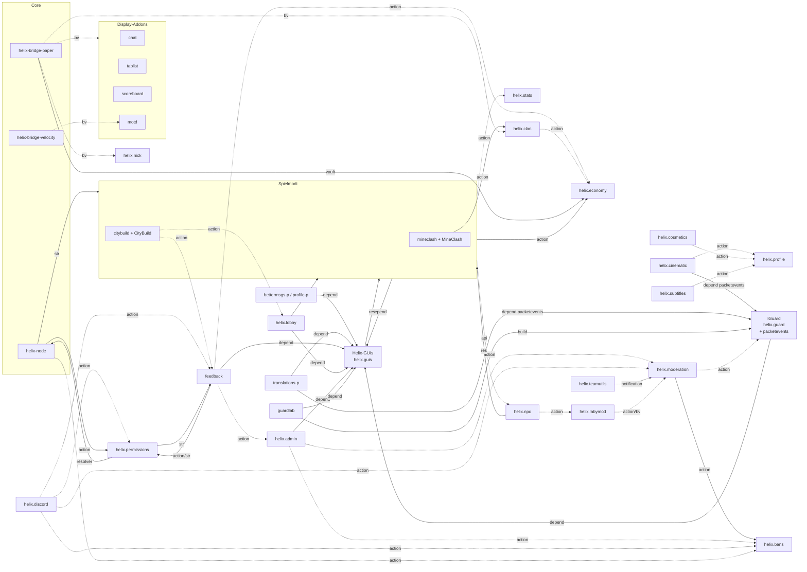

# Abhängigkeiten zwischen den Addons

Diese Übersicht zeigt, **wo die Addons voneinander abhängen**: im Build, über Paper-Plugins, über Actions,
Bridge-Werte, Registries, geteilte Ressourcen, Plugin-Channels und versteckte Text-Verträge. Sie ist die
Grundlage für die Entscheidung, wie die Addons ihre Abhängigkeiten verlieren sollen. Sie beschreibt den
Ist-Zustand und schlägt keine Lösung vor.

Stand: Branch `main`, Oktober 2026, erhoben vor dem Umbau „Helix generisch“ (Tag `theme-baseline`). Die
Spalte **Umbau** in den Tabellen markiert Kopplungen, die durch den geplanten Umbau ohnehin wegfallen:

| Marker | Bedeutung |
|---|---|
| **T2** | entfällt, weil die Spielmodus-Addons (`helix-addon-mineclash`, `helix-addon-citybuild`) in ihre eigenen Repos ziehen und generische Addons ihr Spielmodus-Wissen verlieren (Feedback-Kategorien, Release-Teile, ReleaseConfig-Tasks, Panel-ID-Liste der Permissions-Presets) |
| **T3** | entfällt, weil das Design (Palette, Rang-Glyphen, Wordmark, Villager-Cast, Sounds, Navigator-Karte, Mob-Modelle) als Theme ausgelagert wird und die Design-Objekte aus `helix-api` verschwinden |
| – | bleibt bestehen und ist Gegenstand der Entkopplungs-Entscheidung |

## Schreibweise

- Pfade sind relativ zur Wurzel von Helix-Cloud. Kotlin-Dateien liegen unter `<modul>/src/main/kotlin/…`; da
  Dateinamen pro Modul eindeutig sind, steht nur `modul › Datei.kt:Zeile`.
- Andere Repos: `Mineclash/…` (= `/workspace/Mineclash/gamemodes/mineclash/…`), `CityBuild/…`,
  `helix-labymod-addon/…`, `Kronland/…`.
- Ein „Addon“ ist der Node-Teil zusammen mit seinem `-paper`- bzw. `-velocity`-Teil. Paper-Plugin-Namen stehen
  in Anführungszeichen („Helix-GUIs“).

### Arten von Abhängigkeiten

| Kürzel | Bedeutung |
|---|---|
| **BUILD** | Gradle-Abhängigkeit, `helixJar()`/`files()` in den Spiel-Repos, eingebettetes (geshadetes) JAR |
| **PLUGIN** | `plugin.yml` `depend`/`softdepend`, Klassen eines anderen Plugins, ServicesManager-Lookup |
| **ACTION** | Aufruf einer Action, die einem anderen Addon gehört |
| **BV** | Bridge-Wert: das eine Addon veröffentlicht ihn, ein anderes liest ihn |
| **REG** | Registries und Ereignisse: Resolver, Provider, JoinGate, Listener, Notification-Kategorien, Release-Reset |
| **RES** | geteilte Ressourcen: Fonts, Glyphen, Sounds, Modelle, Sprachschlüssel, Rechte-Knoten, Panel-IDs |
| **CHAN** | Plugin-Message-Channel `helix:*` |
| **STR** | versteckte Text- oder Schema-Kopplung: fest verdrahtete IDs, geparste Ausgaben, kopierte Datenklassen |

### Stärke

| Stärke | Bedeutung |
|---|---|
| **hart** | Fehlt das andere Addon, lädt das Plugin nicht, der Build bricht oder die ganze Funktion fällt aus |
| **funktional hart** | lädt, aber die Funktion ist ohne das andere Addon nutzlos; der Code fängt den Fehler sauber ab |
| **weich** | degradiert sauber (Standardwerte, ausgeblendete Knöpfe, leere Listen) |
| **halbweich** | funktioniert, zeigt dem Nutzer aber einen rohen Fehler oder verschluckt Eingaben |
| **Vertrag** | reine Text-/Schema-Absprache, bricht still, wenn sich das Gegenüber ändert |

---

## 1. Grundsätze

1. **Keine Compile-Abhängigkeit zwischen Node-Addons.** Jedes Node-Addon hängt nur an `helix-addon-sdk`
   (z. B. `helix-addon-admin/build.gradle.kts:8`). Alle Kopplungen zwischen Addons entstehen zur Laufzeit über
   Zeichenketten: Action-Namen, Bridge-Wert-Schlüssel, Notification-Kategorien, Rechte-Knoten, Panel-IDs.
2. **`addon.json` kennt kein Abhängigkeitsfeld** (`helix-api › AddonManifest.kt`). Addons werden alphabetisch
   nach HXA-Dateinamen geladen (`helix-node › AddonManager.kt:225-252`).
3. **Fehlende Actions werfen nicht.** Ein Aufruf liefert `error("unknown action: …")`
   (`helix-node › ActionRegistry.kt:111`).
4. **Paper-Plugins hängen nicht an „HelixPaperBridge“.** Jedes Plugin bettet `helix-api` und `helix-wire` ein und
   spricht über `ServiceNodeApi` und die `HELIX_*`-Umgebungsvariablen selbst mit dem Node.
5. **Bridge-Aufrufe prüfen nur zwei Flags:** `bridgeInvocable` und `bridgeTasks`
   (`helix-node › BridgeActionService.kt:47-52`). Ob das besitzende Addon auf dem Task des Aufrufers aktiv ist,
   wird nicht geprüft.
6. **Bridge-Werte werden pro Task gefiltert.** Ein Wert erreicht einen Service nur, wenn das besitzende Addon für
   dessen Task aktiv ist (`helix-node › WireDispatch.kt:127`, `ControlServer.kt:1379`).
7. **`disabledAddons` steuert auch die Paper-Installation.** Ein Paper-Teil wird nur auf Tasks installiert, auf
   denen sein Addon aktiv ist (`docs/ADDONS.md`, Abschnitt „Pro-Task-Aktivierung“). Das Kronland-Bundle nutzt das
   (`Kronland/Helix/tasks/CityBuild.toml`, `Kronland/local.sh`, `Kronland/setup.sh`).

---

## 2. Überblick

Die wichtigsten Kanten. Durchgezogene Pfeile sind harte oder funktional harte Kopplungen, gestrichelte weiche.
Die Display-Addons und die Spielmodi sind gruppiert.

---

## 3. Addons im Einzelnen

### Helix-GUIs (`helix-addon-guis` + `guis-paper`)

**Hängt ab von**

| Art | Was | Beleg | Umbau |
|---|---|---|---|
| BUILD | bettet `:helix-gui` ein | `helix-addon-guis-paper/build.gradle.kts:30` | – |
| BUILD | Pack-Generator nutzt `RankBadges`, `Wordmark`, `Crown`, `NetworkSounds`, `Villagers`, `LedgerLayout` | `guis-paper › PackGenerator.kt:35,193-210,250` | T3 |
| ACTION | nur eigene `guis.texture.*` | `helix-addon-guis › GuisAddon.kt` | – |

**Wird genutzt von**

| Art | Wer | Beleg | Umbau |
|---|---|---|---|
| PLUGIN | `depend: [Helix-GUIs]`: bettermsgs-paper, feedback-paper, guardlab-paper, lobby-paper, admin-paper, profile-paper, translations-paper, IGuard, CityBuild, MineClash | jeweilige `plugin.yml` (feedback-paper `:6`, translations-paper `:7`, guard-paper `:7`, `CityBuild/src/main/resources/plugin.yml:10`, `Mineclash/src/main/resources/plugin.yml:9`) | – |
| PLUGIN | geteilte IGui-Instanz über den ServicesManager (`awaitSharedIGui`) | registriert in `guis-paper › HelixGuisPlugin.kt:41-46`, `helix-gui › SharedInstance.kt:16,29`; abgeholt in BetterMsgsPlugin.kt:148, FeedbackMenus.kt:67, GuiService.kt:95 (IGuard), ServerMenu.kt:87 (Lobby), ProfileGuiService.kt:73, TranslationsPlugin.kt:121, `Mineclash/… CardTableGui.kt:70`, `CityBuild/… Guis.kt:40` | – |
| PLUGIN | liefert anderen Plugins **Kotlin-Stdlib, Coroutines und Serialization** zur Laufzeit; deren JARs filtern `kotlin*` heraus | admin-paper `build.gradle.kts:43-45`, feedback-paper `:48-49`, guardlab-paper `:49-50`, guard-paper `:63-67`, lobby-paper `:39-41`, profile-paper `:41-45`, translations-paper `:47-50`, bettermsgs-paper `:41-45`; admin-paper und guardlab-paper importieren nichts aus igui und hängen **nur** wegen der Kotlin-Laufzeit an Helix-GUIs | – |
| RES | Fonts im Namespace `helix_guis`: `icons` (Krone U+E000), `spaces`, `ranks`, `wordmark`, Ledger-/Screen-Fonts, Villager-Köpfe | `helix-api › Crown.kt:9`, `helix-node › HelixNode.kt:415-417` (`{wordmark}`, `{crown}`), `helix-addon-citybuild/src/main/lang/*/hud.json:2`, `Mineclash/… Icons.kt:26`, `Mineclash/… CardTableGui.kt:63`, `RankBadges.kt:12`, permissions `panel.html:70`; Ledger in bettermsgs, feedback, guard, lobby, profile, translations, `CityBuild/… BookMenu.kt:93` | T3 |
| RES | Sounds im Namespace `reich:*` | `helix-gui › NetworkSounds.kt:18`; genutzt von lobby-paper, IGuard, CityBuild, `Mineclash/… Sounds.kt:22-24`; npc-paper kopiert die Schlüssel als Text (`VillagerVoice.kt:6-11`) | T3 |
| RES | Spielmodus-Inhalt in diesem generischen Modul: MineClash-Sounds (`NetworkSounds.kt:39-68`, `guis-paper/src/pack/resources/sounds/mineclash/`), CityBuild-Figuren in `Villagers.IDS` (`helix-gui › Villagers.kt:10-14`) | | T2/T3 |

### IGuard (`helix-addon-guard` + `guard-paper`, Plugin „IGuard“)

**Hängt ab von**

| Art | Was | Beleg | Umbau |
|---|---|---|---|
| PLUGIN | `depend [packetevents, Helix-GUIs]`, `softdepend ViaVersion` | `helix-addon-guard-paper/src/main/resources/plugin.yml:7-8` | – |
| BUILD | compileOnly `:helix-gui`; bettet `libs/rune-base` ein | `guard-paper/build.gradle.kts:37,39` | – |
| RES | igui, `NetworkSounds`, `LedgerScreen` | | T3 (Optik) |
| ACTION | eigene `guard.store.*`/`guard.query.*`; Core `service.list`, `service.command … iguard reload`, `player.kick`, `player.message` | `HelixNodeStore.kt:115-340`, `GuardAddon.kt:178-183`, `GuardStoreActions.kt:639,731` | – |
| REG | JoinGate | `GuardAddon.kt:59` | – |
| STR | schreibt `plugins/IGuard/config.yml` in Service-Verzeichnisse | `GuardAddon.kt:169-171` | – |

**Wird genutzt von**

| Art | Wer | Beleg | Umbau |
|---|---|---|---|
| PLUGIN | bettet die **einzige** `packetevents.jar` der Server ein; HelixCinematic (`depend`, `plugin.yml:6`) und Helix-Translations (`depend`, `plugin.yml:7`) brauchen sie zwingend, HelixCosmetics (`CosmeticsPlugin.kt:51`) und HelixPaperBridge (Nick-Tags, `HelixPaperBridgePlugin.kt:137-145`) optional; MineClash bettet eine **eigene** Kopie ein (`Mineclash/build.gradle.kts:85`) | `helix-addon-guard/build.gradle.kts:14-47` | – |
| PLUGIN | `IGuardApi` über den ServicesManager: guardlab-paper (compileOnly + `Probe.kt:136-137`), feedback-paper (per Reflection, `ContextCapture.kt:103-104`) | `IGuardPlugin.kt:218` | – |
| ACTION | moderation ruft `guard.query.incidents` | `ModerationAddon.kt:311` | – |
| RES | Recht `iguard.bypass` in guardlab-paper | `Runner.kt:939` | – |
| STR | Kronland-Templates liefern `plugins/IGuard`-Configs; Permissions-Preset nennt `helix.panel.addon.guard` | `Kronland/Helix/templates/{Lobby,MineClash,Proxy}/plugins/IGuard`, `PanelAccess.kt:214` | T2 (Panel-Liste) |

### guardlab (`helix-addon-guardlab` + `guardlab-paper`, Plugin „GuardLab“)

| Richtung | Art | Was | Beleg | Umbau |
|---|---|---|---|---|
| hängt ab von | BUILD | compileOnly `:helix-addon-guard-paper` | `guardlab-paper/build.gradle.kts:26` | – |
| hängt ab von | PLUGIN | `depend Helix-GUIs` (nur Kotlin-Laufzeit), `softdepend IGuard`; Laufzeitprüfung `getPlugin("IGuard")` | `plugin.yml:6-7`, `Probe.kt:136` | – |
| hängt ab von | RES | `iguard.bypass` | | – |
| hängt ab von | STR | Task `IGuard-Test` fest verdrahtet | `GuardLabAddon.kt:65,128`, `GuardLabPlugin.kt:445` | – |
| hängt ab von | CHAN | `helix:guardlab` ↔ LabyMod-Dev-Client | `Protocol.kt:20` ↔ `helix-labymod-addon/guardlab/core/…/GuardLabChannel.java:45` | – |
| wird genutzt von | STR | `Kronland/local.sh` (GuardLab-Modus), Permissions-Preset | `PanelAccess.kt:229` | T2 (Panel-Liste) |

### helix.permissions

**Hängt ab von**

| Art | Was | Beleg | Umbau |
|---|---|---|---|
| REG | PermissionResolver, DisplayResolver (Prefix), PlayerDataProvider, `serviceDirectories` (liest plugin.yml-Dateien) | `PermissionsAddon.kt:49,56,61`, `PermissionCatalog.kt:21` | – |
| RES | `helix-api` `RankBadges`/`PlayerRanks` (Font `helix_guis:ranks`) | `RankBadgeUpgrade.kt:61`, `TesterAccess.kt:36,134-140` | T3 |
| STR | kennt feedback: `FEEDBACK_STAFF`, `FEEDBACK_REPORT`, `EXTRAS`, `IMPLIED_BY feedback.report ← feedback.staff`, Tester-Gruppe mit `feedback.report`, `feedback.tester`, `tester.tools` | `PanelAccess.kt:172-176,186-192`, `PermissionsAddon.kt:283`, `TesterAccess.kt:226-233` | – |
| STR | fest verdrahtete Panel-IDs der Presets (feedback, testguide, bugreport, bans, guard, clan, economy, lobby, motd, tablist, scoreboard, chat, profile, mineclash, cinematic, labymod, guardlab, discord) | `PanelAccess.kt:208-233` | T2 |
| REG | Release-Teilnehmer `perm.release.reset` mit `--remove-testers` | `PermissionsAddon.kt:203` | – |

**Wird genutzt von**

| Art | Wer | Beleg | Umbau |
|---|---|---|---|
| REG | **jedes** `context.hasPermission` (einziger PermissionResolver); Bukkit-Rechte aller Paper-Plugins über den Node-Snapshot | `WireDispatch.kt:81-86` → `ControlServer.kt:262-276` (inkl. `perm.catalog`) → `helix-bridge-paper › HelixPermissionProvider` | – |
| ACTION | Node: `perm.catalog`, `perm.group.list/info/grant/revoke` (Zugriffs-Matrix) | `ControlServer.kt:280-289`, `PanelCapabilities.kt:39-41` | – |
| ACTION | Dashboard: `perm.access.matrix/set/presets` | `helix-dashboard/src/views/access.tsx:54,92,104` | – |
| ACTION | feedback: `perm.user.grant` | `FeedbackAddon.kt:461,510` | – |
| ACTION | discord: `perm.user.*`, `perm.group.*` | `BotRuntime.kt:624-636,1056`, `DiscordUi.kt:337` | – |

### helix.bans

| Richtung | Art | Was | Beleg | Umbau |
|---|---|---|---|---|
| hängt ab von | ACTION/REG | Core `player.kick`; JoinGate, PlayerDataProvider, `sharedAddressPlayers`; Notification-Kategorie `moderation` | `BansAddon.kt:29,36,55,95,177` | – |
| wird genutzt von | ACTION | admin `ban.set` | `AdminAddon.kt:155` | – |
| wird genutzt von | ACTION/STR | moderation: `ban.set` für `/tempban`; `ban.check` mit **Text-Parsing** „not banned“ | `ModerationAddon.kt:118,282-293` | – |
| wird genutzt von | ACTION | discord: `ban.set`, `ban.pardon`, `ban.history` | `BotRuntime.kt:652-655`, `DiscordUi.kt:271-279` | – |
| wird genutzt von | ACTION/STR | Node: `ban.export` (Snapshot), REST `ban.set`; Velocity-Bridge **kopiert das `BanEntry`-Schema** | `WireDispatch.kt:131`, `ControlServer.kt:986,1385-1389`, `helix-bridge-velocity › CachedBan.kt:6-7` | – |
| wird genutzt von | REG | teamutils und discord über die Kategorie `moderation` | | – |

### helix.moderation

| Richtung | Art | Was | Beleg | Umbau |
|---|---|---|---|---|
| hängt ab von | ACTION | bans (`ban.set`, `ban.check` mit Text-Parsing), guard (`guard.query.incidents` + JSON-Parsing), Core `player.*` | `ModerationAddon.kt:118,293,305-322` | – |
| hängt ab von | BV | veröffentlicht `moderation.mutes`, `moderation.blocklist`, `moderation.muteMessage`, `moderation.blockedMessage` | `ModerationAddon.kt:332-358` | – |
| hängt ab von | REG | Notification-Kategorie `moderation` | `ModerationAddon.kt:57,74,136,153` | – |
| wird genutzt von | BV | Chat-Gate der Paper-Bridge | `HelixPaperBridgePlugin.kt:315-341` | – |
| wird genutzt von | ACTION | admin `warn`; discord `warn`, `mute` | `AdminAddon.kt:142`, `BotRuntime.kt:614-619`, `DiscordUi.kt:260-266` | – |
| wird genutzt von | ACTION/STR | labymod `mute.export` + kopiertes `MuteValue`-Schema | `LabyModAddon.kt:414`, `LabyState.kt:82` | – |
| wird genutzt von | REG | teamutils hört auf `moderation`; discord-Standard `notificationCategories = ["moderation"]` | `TeamUtilsAddon.kt:83-85`, `DiscordConfig.kt:55` | – |

### helix.admin (`helix-addon-admin` + `admin-paper`, Plugin „HelixAdmin“)

| Richtung | Art | Was | Beleg | Umbau |
|---|---|---|---|---|
| hängt ab von | ACTION | bans `ban.set`, moderation `warn`; Core `player.kick/message/broadcast`, `service.list/restart` | `AdminAddon.kt:136-160,227-228` | – |
| hängt ab von | PLUGIN | Helix-GUIs (nur Kotlin-Laufzeit) | | – |
| hängt ab von | BV | eigener Wert `admin.panel_url` | `AdminAddon.kt:234,251` → `AdminPlugin.kt:95` | – |
| hängt ab von | CHAN | `helix:admin` und `BungeeCord` ↔ LabyMod-Addon und Fabric-Admin-Mod | `AdminPlugin.kt:502-503` ↔ `helix-labymod-addon/…/AdminClient.java:35`, `helix-admin-mod/…/HelixAdminClient.kt:23` | – |
| wird genutzt von | ACTION | feedback: `admin.panelurl`, `admin.teleport.location` | `FeedbackAddon.kt:395-397`, feedback `panel.html:403` | – |
| wird genutzt von | ACTION | Dashboard: In-Game-Menü (`admin.*`) | `helix-dashboard/src/views/ingame-menu.tsx:12,236-349` | – |

### feedback (`helix-addon-feedback` + `feedback-paper`, Plugin „HelixFeedback“)

**Hängt ab von**

| Art | Was | Beleg | Umbau |
|---|---|---|---|
| ACTION | admin `admin.panelurl`, `admin.teleport.location`; economy `eco.api.deposit` (auch Test-Kronen in Paper); permissions `perm.user.grant`; Core `service.logs` | `FeedbackAddon.kt:92,395-397,461,501,510`, `FeedbackNodeClient.kt:63,322` | – |
| RES | Badge-Knoten `PlayerRanks.BETA_TESTER_BADGE` | `FeedbackAddon.kt:437` | T3 (Objekt zieht um) |
| PLUGIN | `depend Helix-GUIs`, `softdepend IGuard` (per Reflection) | `feedback-paper/src/main/resources/plugin.yml:6-7` | – |
| STR | CityBuild: `PART_CITYBUILD`, `CITYBUILD_TASK = "CityBuild"` | `ReleaseRewards.kt:36`, `FeedbackPlugin.kt:174-177,523` | T2 |
| STR | Kategorien `mineclash`, `citybuild`, … fest im Code, Befehlsliste aller Module von Hand | `Models.kt:185`, `FeedbackModel.kt:46-49,84-85`, `TestGuide.kt:48`, `testguide/commands.json` | T2 |
| RES | Recht `tester.tools` (von permissions angelegt) | `FeedbackPlugin.kt:526` | – |
| CHAN | `helix:feedback` (Screenshots) | `FeedbackPlugin.kt:535` ↔ `helix-labymod-addon/…/FeedbackChannel.java:43` | – |
| REG | ProfileInfoProvider, Release-Teilnehmer | `FeedbackAddon.kt:406,432` | – |

**Wird genutzt von**

| Art | Wer | Beleg | Umbau |
|---|---|---|---|
| ACTION/STR | discord: `feedback.*`, Notification `feedback-event` (Payload `BugModels.kt:94,109` spiegelt `Models.kt:243,258`), Kategorien kopiert | `BugPorts.kt:103-157`, `BugTags.kt:16,31-33` | T2 (Kategorien) |
| ACTION | CityBuild: `feedback.rewards.pending/redeem` | `CityBuild/… ReleaseRewardModule.kt:23,51,70` | T2 |
| ACTION/STR | Dashboard: integrierte Ansichten `testguide`, `bugreport` (Standard-Kategorie `"mineclash"`) | `helix-dashboard/src/lib/integrated.ts:7`, `views/bugreport.tsx:27,216` | T2 (Kategorie) |
| STR | permissions: Presets und `IMPLIED_BY` | siehe permissions | – |
| REG | Notification-Kategorien `bugreport`/`bugreport-staff` nur mit konfiguriertem Discord | `FeedbackService.kt:828` | – |

### helix.economy

| Richtung | Art | Was | Beleg | Umbau |
|---|---|---|---|---|
| hängt ab von | ACTION/REG | Core `player.message`; PlayerListener, PlayerDataProvider, `eco.release.reset` | `EconomyAddon.kt:177` | – |
| wird genutzt von | ACTION | `eco.api.*` (Bridge-aufrufbar, `EconomyAddon.kt:203-242`): citybuild-Addon (`KronenGateway.kt:75-106`, **Text-Parsing** der Fehler), CityBuild (`Kronen.kt:74-78,117-179`, `OpJournal.kt:391-469`, `DealerMenu.kt:35`, `JobsMenu.kt:60`), MineClash (`ExchangeDesk.kt:100-192`), mineclash-Addon (`KronenRewards.kt:44,68`), clan (`eco.give`/`eco.take`, `ClanAddon.kt:503-508,538`), feedback, Vault-Anbieter der Paper-Bridge (`VaultEconomyHook.kt:27,41-42,104,141,163`) | | T2 (Spielmodi ziehen um, Aufrufe bleiben) |
| wird genutzt von | BV | `economy.balance.<player>` (`EconomyAddon.kt:295`): Paper-Bridge (`HelixPaperBridgePlugin.kt:103` Laby-HUD, `:637` Scoreboard, `NetworkPlaceholders.kt:38`, `VaultEconomyHook.kt:100`), labymod-velocity (`LabyModVelocityPlugin.kt:176`), CityBuild (`KronenModule.kt:32-49`) | | – |

### helix.stats

| Richtung | Art | Was | Beleg | Umbau |
|---|---|---|---|---|
| hängt ab von | REG | nur Release-Teilnehmer | `StatsAddon.kt:65` | – |
| wird genutzt von | ACTION/STR | citybuild-Addon `stats.add`/`stats.top` mit **Parsing** der Zeilen `#n name - v`; mineclash-Addon `stats.add` | `ProfileService.kt:45,135,149`, `StatsReporter.kt:42` | T2 (Aufrufer ziehen um) |

### helix.clan

| Richtung | Art | Was | Beleg | Umbau |
|---|---|---|---|---|
| hängt ab von | ACTION | economy (Clan-Bank) | `ClanAddon.kt:503-508,538` | – |
| hängt ab von | REG/BV | DisplayResolver (**Suffix**), PlayerListener, DataProvider, `clan.release.reset`; veröffentlicht `clan.tag.<player>` | `ClanAddon.kt:44-46,102,224-226` | – |
| wird genutzt von | ACTION/RES/STR | mineclash-Addon: `clan.list`, `clan.detail`, Parsing „no such clan“ und Clan-JSON, leitet `clan` weiter, prüft `helix.clan` | `ClanLookup.kt:155-207`, `MineClashAddon.kt:211,221,232,234` | T2 (Aufrufer zieht um) |
| wird genutzt von | ACTION | MineClash indirekt über `mineclash.clan.*` | `Mineclash/… HelixClans.kt:34-55` | T2 |
| wird genutzt von | BV/ACTION | Paper-Bridge: `clan.tag` (`NetworkPlaceholders.kt:39`, `HelixPaperBridgePlugin.kt:638`) und `@clan` → `cc` (`:908`) | | – |

### helix.nick

| Richtung | Art | Was | Beleg | Umbau |
|---|---|---|---|---|
| hängt ab von | REG | DisplayResolver mit `exclusive = true` verdrängt Rang-Prefix und Clan-Suffix | `NickAddon.kt:42-45`, `helix-node › DisplayResolverRegistry` | – |
| hängt ab von | RES | Standard-Prefix aus `StaffRanks` | `NickAddon.kt:186` | T3 |
| wird genutzt von | BV | `nick.name.<player>` → Paper-Bridge (Namensschild per packetevents) | `NickAddon.kt:123`, `HelixPaperBridgePlugin.kt:198,427` | – |

### Display-Addons (veröffentlichen Bridge-Werte, die eine Bridge rendert)

| Addon | Bridge-Wert | Konsument | Anmerkung | Umbau |
|---|---|---|---|---|
| helix.chat | `chat.format` (`PrettyChatAddon.kt:29,41`) | Paper-Bridge (`:289`) | Platzhalter kommen von permissions, nick und clan | – |
| helix.tablist | `tablist.header`, `tablist.footer`, `tablist.config` (`TablistAddon.kt:93-95`) | Paper-Bridge (`:452-473`) | Schema kopiert in `TablistData.kt` | – |
| helix.scoreboard | `scoreboard.config` (`ScoreboardAddon.kt:122`) | Paper-Bridge (`:455`) | Schema kopiert in `ScoreboardData.kt`; `{balance}`/`{clan}` von economy und clan | – |
| helix.motd | `motd.config` (`MotdAddon.kt:141`) | Velocity-Bridge (`HelixVelocityBridgePlugin.kt:589`) | Schema kopiert in `MotdData.kt`; Standardtext nennt MineClash und CityBuild (`MotdConfig.kt:16`) | T2/T3 (Standardtext) |
| helix.maprotation | `maprotation.<id>.current`, `.next` (`MapRotationAddon.kt:88-89`) | **keiner** | siehe „Sonstiges“ | – |

### helix.teamutils, helix.discord, helix.labymod

| Addon | Richtung | Art | Was | Beleg | Umbau |
|---|---|---|---|---|---|
| teamutils | hängt ab von | REG | hört auf Notification-Kategorie `moderation` (von bans und moderation) | `TeamUtilsAddon.kt:83-85` | – |
| teamutils | wird genutzt von | ACTION | `@team`-Prefix der Paper-Bridge ruft `tc` | `HelixPaperBridgePlugin.kt:908` | – |
| discord | hängt ab von | ACTION/REG | bans, moderation, permissions, feedback, ~20 Core-Actions; ActionObserver über alle Actions, NotificationListener, `installedAddons` | `DiscordBotAddon.kt:80-81` | – |
| discord | – | – | **degradiert sauber**: Knöpfe nur, wenn `bot.catalog.find(...)` die Action findet; Aufrufe in `runCatching` | `DiscordUi.kt:260-279`, `BugPorts.kt:161` | – |
| labymod | hängt ab von | ACTION/BV/STR | moderation `mute.export` + Schema-Kopie; liest `economy.balance.*`, `subtitle.text.*`, `network.name`; LabyMod-Server-API | `LabyModVelocityPlugin.kt:176,191,208`, `helix-addon-labymod/build.gradle.kts:28-29` | – |
| labymod | wird genutzt von | ACTION | npc-paper: `labymod.npc.entity`, `labymod.npc.clicked` (bridge-aufrufbar) | `NpcPlugin.kt:552,563`, `LabyModAddon.kt:102,118` | – |

### helix.npc (`helix-addon-npc` + `npc-paper`, Plugin „Helix-NPC“)

| Richtung | Art | Was | Beleg | Umbau |
|---|---|---|---|---|
| hängt ab von | ACTION | labymod (best effort, fire-and-forget) | `NpcPlugin.kt:552,563` | – |
| hängt ab von | RES | Stimmen `reich:villager.*` aus dem Helix-GUIs-Pack | `VillagerVoice.kt:6-11` | T3 |
| hängt ab von | BUILD | `libs/inpc-1.0.0-SNAPSHOT.jar` | | – |
| wird genutzt von | PLUGIN/BUILD | CityBuild und MineClash: `softdepend Helix-NPC`, compileOnly `helixJar("helix-addon-npc-paper")`, `HelixNpcApi` über den ServicesManager | `NpcPlugin.kt:130`; `CityBuild/build.gradle.kts:66`, `Mineclash/build.gradle.kts:92`; `CityBuild/… RigVisuals.kt:307-309`, `CityVillagers.kt:272-274`, `Mineclash/… HelixVillagers.kt:106,129`, `TroopRigs.kt:69,315` | – |
| wird genutzt von | BUILD | **Pfad zur inpc-JAR**: cinematic-paper (eingebettet, `build.gradle.kts:30`), cosmetics-paper (compileOnly, `:27`), helix-library-cinematic (`:25`) | | – |
| wird genutzt von | RES | Spielmodus-Inhalt: MineClash- und CityBuild-Cast mit Modellen | `VillagerCast.kt:37-59` | T2/T3 |

### helix.cinematic, helix.cosmetics, helix.subtitles, helix.profile

| Addon | Richtung | Art | Was | Beleg | Umbau |
|---|---|---|---|---|---|
| cinematic | hängt ab von | ACTION/REG | profile `profile.setting.get`, ProfileSettingProvider | `CinematicAddon.kt:51,78` | – |
| cinematic | hängt ab von | PLUGIN | `depend packetevents` (kommt aus helix.guard) | `cinematic-paper/src/main/resources/plugin.yml:6` | – |
| cinematic | hängt ab von | BUILD | bettet `helix-library-cinematic` und inpc ein | `cinematic-paper/build.gradle.kts:28-30` | – |
| cinematic | hängt ab von | CHAN/STR | `helix:afk`; Standard-Tasks `["Lobby"]` | `CinematicPlugin.kt:295` ↔ `helix-labymod-addon/…/HelixChannel.java:40`; `CinematicConfig.kt:22`, `CinematicSettings.kt:22` | – |
| cosmetics | hängt ab von | ACTION/REG | profile, Provider | `CosmeticsAddon.kt:29,88` | – |
| cosmetics | hängt ab von | PLUGIN | optional packetevents und HelixCinematic | `CosmeticsPlugin.kt:51,64`, `plugin.yml:6` | – |
| cosmetics | hängt ab von | BUILD/CHAN | compileOnly library-cinematic und inpc; `helix:cosmetics` | `cosmetics-paper/build.gradle.kts:26-27`, `AddonCosmetics.kt:50` ↔ `HelixChannel.java:33` | – |
| subtitles | hängt ab von | ACTION/REG | profile, Provider | `SubtitleAddon.kt:38,147` | – |
| subtitles | wird genutzt von | BV | labymod-velocity liest `subtitle.text.*` | `LabyModVelocityPlugin.kt:191` | – |
| profile | hängt ab von | REG/PLUGIN | Aggregations-APIs `profileInfo`, `profileSettings`, `notify…`, `validate…`; Helix-GUIs | `ProfileAddon.kt:85-197` | – |
| profile | wird genutzt von | ACTION/REG/STR | Setting-Leser cinematic, cosmetics, subtitles; Info-Provider citybuild (`CityBuildAddon.kt:123`) und feedback (`:432`); Lobby-Hotbar-Item ruft `/profilemenu` (`LobbyConfig.kt:78`) | | T2 (citybuild) |

### helix.lobby (`helix-addon-lobby` + `lobby-paper`, Plugin „HelixLobby“)

| Richtung | Art | Was | Beleg | Umbau |
|---|---|---|---|---|
| hängt ab von | PLUGIN | Helix-GUIs | | – |
| hängt ab von | STR | parst das Zeilenformat von `service.list` | `LobbyAddon.kt:154-175` | – |
| hängt ab von | STR | `/profilemenu` von profile-paper | `LobbyConfig.kt:78` | – |
| hängt ab von | STR/RES | Navigator-Orte mit Spielmodus-Inhalt und Villager-Köpfen; Task `"Lobby"` | `NavigatorGlyphs.kt:82-89`, `NavigatorGuess.kt:9-19`, `LobbyAddon.kt:214` | T2/T3 |
| wird genutzt von | ACTION | CityBuild: `lobby.servers` (bridge-aufrufbar) | `CityBuild/… InstanceMenu.kt:50`, `LobbyAddon.kt:73-77` | T2 |
| wird genutzt von | STR | cinematic (Standard-Task), Permissions-Preset | | T2 (Panel-Liste) |

### Kleine Addons

| Addon | Abhängigkeiten | Umbau |
|---|---|---|
| helix.translations („Helix-Translations“) | Node-Teil leer (`TranslationsAddon.kt`); Paper-Teil nutzt die **Core**-Actions `helix.translations.*` (`NodeClient.kt:100-105`, `helix-node › TranslationActions.kt:201-207`), `depend [Helix-GUIs, packetevents]` | – |
| helix.bettermsgs („BetterMSGs“) | Helix-GUIs und Core `player.message` | – |
| helix.friends, helix.parties, helix.example | nur Core-Actions; nur in der Befehlsliste von feedback erwähnt | – |
| helix.mobs | reines Pack (440 `minecraft:`-Assets); auf IGuard-Test deaktiviert | T3 (Addon entfällt) |

### mineclash (Node-Addon) und MineClash (Paper-Plugin)

| Richtung | Art | Was | Beleg | Umbau |
|---|---|---|---|---|
| Addon hängt ab von | ACTION/RES | clan (Actions und `helix.clan`), economy, stats; Core `player.connect`, `service.start`, `service.list` | `WarEffectRunner.kt:73-110` | T2 |
| Addon hängt ab von | STR | Task-Namen `MineClash-Game`/`MineClash-War` | `MineClashAddon.kt:129-130`, `ConfigSeeds.kt:48,51` | T2 |
| Plugin hängt ab von | PLUGIN/ACTION | Helix-GUIs, Helix-NPC (optional), economy `eco.api.*` | | T2 |
| Plugin hängt ab von | CHAN | `helix:hud`, **geteilt** mit der Paper-Bridge; das LabyMod-Addon definiert MineClash-HUD-Widgets | `Mineclash/… LabyHud.kt:21`, `helix-bridge-paper › LabyHud.kt:52`, `helix-labymod-addon/…/HelixValueWidget.java:33-41` | – |
| Plugin hängt ab von | RES | `NetworkSounds.MINECLASH_*`, `helix_guis:icons`/`spaces` | | T2/T3 |
| Plugin hängt ab von | STR | Rückfall auf Service `"Lobby-1"` | `Mineclash/… WarNodeSync.kt:243` | – |
| Plugin hängt ab von | BUILD | `helixJar`; Sprachdateien aus `helix-addon-mineclash/…/lang`; Deploy nach `helix-addon-mineclash/libs` | `Mineclash/build.gradle.kts:70,89-93,135` | T2 |
| wird genutzt von | STR | Node `ReleaseConfig`, feedback/discord/dashboard-Kategorien, Lobby-Navigator, Helix-GUIs-Sounds, npc-Cast, LabyMod-HUD, Permissions-Preset | `ReleaseConfig.kt:49-50` | T2/T3 |

### citybuild (Node-Addon) und CityBuild (Paper-Plugin)

| Richtung | Art | Was | Beleg | Umbau |
|---|---|---|---|---|
| Addon hängt ab von | ACTION/REG | economy, stats, `storageConnection`; ProfileInfoProvider; `bridgeTasks = "CityBuild"` | `CityBuildAddon.kt:96`, `ConfigSeeds.kt:39-42` | T2 |
| Plugin hängt ab von | PLUGIN | Helix-GUIs; **`depend Vault`**, dessen Economy-Anbieter **nur** HelixPaperBridge registriert (braucht das economy-Addon); Helix-NPC optional | `CityBuild/src/main/resources/plugin.yml:9-10`, `VaultEconomyHook.kt:27` | – |
| Plugin hängt ab von | ACTION/BV | economy (Actions und `economy.balance`), feedback-Belohnungen, `lobby.servers` | | T2 |
| Plugin hängt ab von | BUILD | `helixJar` für api, wire, gui, npc-paper; Sprach-Fragmente aus `helix-addon-citybuild/src/main/lang`; Deploy nach `…/libs` | `CityBuild/build.gradle.kts:64-66,110,243` | T2 |
| wird genutzt von | STR | Node `ReleaseConfig` (Task und Plugin-Dateinamen `plugins/CityBuild/*.json`), feedback (`PART_CITYBUILD`, `CITYBUILD_TASK`, Kategorien), helix-gui `Villagers`, npc `VillagerCast`, Lobby-Ort `kronstadt`, discord-Tags | `ReleaseConfig.kt:33-46` | T2/T3 |

### Core-Module, die Addon-Verträge kennen

| Modul | Was es über Addons weiß | Umbau |
|---|---|---|
| helix-node | `ban.export`/`ban.set` (bans), `perm.catalog`/`perm.group.*` (permissions); Release-Orchestrator findet alle `*.release.reset` (`NodeReleaseHost.kt:76-79`: eco, stats, feedback, perm, citybuild, mineclash, clan); `ReleaseConfig` mit CityBuild-/MineClash-Tasks; `{wordmark}`/`{crown}` aus `helix_guis`-Glyphen (`HelixNode.kt:415-417`); bettet beide Bridges in `Launcher.jar` ein (`helix-node/build.gradle.kts:56-80`) | T2 (ReleaseConfig), T3 (Glyphen) |
| helix-bridge-paper | liest Bridge-Werte von chat, tablist, scoreboard, moderation, nick, clan, economy; Vault → `eco.api.*`; `@team`/`@clan` → `tc`/`cc`; Channel `helix:hud`; `softdepend [packetevents, Vault, PlaceholderAPI]` (`plugin.yml:7`) | – |
| helix-bridge-velocity | liest `motd.config`, den Ban-Snapshot (Schema von bans) und `network.*` | – |
| helix-api | `PlayerRanks.BETA_TESTER_BADGE` (feedback, permissions); `Crown`/`Wordmark`/`RankBadges` (Glyphen des GUIs-Packs); `ReleaseReset`-Protokoll; KDoc erwähnt `ban.export`/`eco.export` | T3 (Design-Objekte) |
| helix-dashboard | kennt admin-, feedback- und permissions-Actions; Panel-IDs `testguide`/`bugreport` fest | – |
| LabyMod-Client | Channels `helix:hud`, `cosmetics`, `afk` (`HelixChannel.java:27-40`), `admin` (`AdminClient.java:35`), `feedback` (`FeedbackChannel.java:43`), `guardlab` (`GuardLabChannel.java:45`) | – |

---

## 4. Kanten-Tabelle (von → nach)

| Von | Nach | Arten | Stärke | Umbau |
|---|---|---|---|---|
| bettermsgs-p, feedback-p, guardlab-p, lobby-p, admin-p, profile-p, translations-p, IGuard, CityBuild, MineClash | Helix-GUIs | PLUGIN depend, Kotlin-Laufzeit, BUILD compileOnly helix-gui | **hart** | – |
| lobby-p, IGuard, CityBuild, MineClash, npc-p, permissions, node, CityBuild-Sprachdateien | Helix-GUIs-Pack (`helix_guis:*`, `reich:*`) | RES | weich (fehlende Glyphen/Sounds) | T3 |
| Helix-GUIs / helix-gui | mineclash, citybuild | RES-Inhalt (Sounds, Villager-Cast) | Inhalt | T2/T3 |
| cinematic-p, translations-p | IGuard (packetevents) | PLUGIN depend | **hart** | – |
| cosmetics-p, helix-bridge-paper | IGuard (packetevents) | PLUGIN soft | weich | – |
| guardlab | IGuard | BUILD compileOnly, PLUGIN soft, RES Recht, STR Task | Build hart, Laufzeit weich | – |
| feedback | IGuard | PLUGIN soft (Reflection) | weich | – |
| moderation | IGuard | ACTION + JSON-Schema | weich | – |
| admin | bans, moderation | ACTION (Weiterleitung) | halbweich (roher Fehler) | – |
| moderation | bans | ACTION + Text-Parsing | halbweich (`/tempban` roher Fehler) | – |
| discord | bans, moderation, permissions, feedback | ACTION, REG Notification | weich (über den Katalog abgesichert) | – |
| helix-node, helix-bridge-velocity | bans | ACTION, STR Schema | weich (`"[]"`) | – |
| feedback | admin, economy, permissions | ACTION, RES Badge | weich | T3 (Badge-Objekt) |
| feedback | citybuild | STR (Belohnungsteil, Task, Kategorie) | Vertrag | T2 |
| permissions | feedback (und Panel-IDs von ~17 Addons) | STR Rechte-Knoten und Presets | Vertrag | T2 (Panel-Liste) |
| jedes `hasPermission`; helix-bridge-paper → alle Paper-Plugins | permissions | REG Resolver, Snapshot | **funktional hart** | – |
| helix-node, Dashboard | permissions | ACTION | weich (leer / Toast) | – |
| citybuild, CityBuild, MineClash, mineclash, clan, feedback, helix-bridge-paper (Vault) | economy | ACTION, BV | funktional hart, sauber abgefangen | T2 (Spielmodi ziehen um) |
| CityBuild (über Vault) | helix-bridge-paper → economy | PLUGIN, ACTION | **hart** für die PlotSquared-Economy | – |
| citybuild, mineclash | stats | ACTION + Text-Parsing | weich | T2 |
| mineclash (und MineClash indirekt) | clan | ACTION, RES `helix.clan`, STR Text | funktional hart (Krieg deaktiviert, `WarCoordinator.kt:634`) | T2 |
| helix-bridge-paper | chat, tablist, scoreboard, moderation, nick, clan, economy | BV + Schema-Kopien | weich (Vanilla-Rückfall) | – |
| helix-bridge-velocity | motd | BV + Schema | weich | – |
| teamutils | bans, moderation | REG Notification-Kategorie | weich | – |
| labymod | moderation, economy, subtitles | ACTION, BV, STR Schema | weich | – |
| npc | labymod | ACTION | weich (fire-and-forget) | – |
| cinematic, cosmetics, subtitles | profile | ACTION, REG Provider | weich (Standardwerte; cosmetics praktisch inaktiv) | – |
| citybuild, feedback | profile | REG ProfileInfoProvider | weich | T2 (citybuild) |
| lobby | profile-p | STR Befehl `/profilemenu` | weich | – |
| cosmetics-p | cinematic-p | PLUGIN soft, BUILD compileOnly | weich | – |
| cinematic-p, cosmetics-p, helix-library-cinematic, CityBuild, MineClash | npc-paper (inpc-JAR / npc-paper-JAR) | BUILD Dateipfad | **hart** (Build) | – |
| CityBuild, MineClash | npc (`HelixNpcApi`) | PLUGIN soft | weich (Vanilla-Villager) | – |
| CityBuild | lobby, feedback | ACTION | weich | T2 |
| CityBuild, MineClash | Verzeichnisse von citybuild/mineclash in Helix-Cloud | BUILD (Sprachdateien, Deploy nach `libs`) | **hart** (Build) | T2 |
| admin-p, cinematic-p, cosmetics-p, feedback-p, guardlab-p, helix-bridge-paper, MineClash | LabyMod-Client (und Fabric-Admin-Mod) | CHAN | weich | – |
| helix-node | CityBuild/MineClash | STR Tasks, Plugin-Dateipfade | Vertrag | T2 |
| lobby-p | MineClash/CityBuild | STR Navigator-Orte | Inhalt | T2/T3 |

---

## 5. Kopplungsstärke

### Hart (lädt nicht, Build bricht oder Funktion fällt ganz aus)

1. **Helix-GUIs.** Zehn Paper-Plugins haben `depend` darauf. Ist `helix.guis` nicht installiert oder auf einem
   Task deaktiviert, laden alle zehn nicht: Es fehlen Kotlin-Laufzeit und IGui-Instanz. `awaitSharedIGui` wirft
   nach etwa 20 s (`helix-gui › SharedInstance.kt:29-35`).
2. **packetevents steckt nur im HXA von helix.guard.** HelixCinematic und Helix-Translations brauchen es zwingend.
   Wird Guard entfernt oder auf einem Task deaktiviert, fallen AFK-Kamerafahrten und der Übersetzungs-Editor aus.
3. **Build-Pfade:**
   - `helix-addon-npc-paper/libs/inpc-1.0.0-SNAPSHOT.jar` (cinematic-paper, cosmetics-paper, helix-library-cinematic)
   - `:helix-addon-guard-paper` (guardlab-paper)
   - Spiel-Repos: `helixJar(...)` wirft, wenn Helix-Cloud nicht gebaut ist (`CityBuild/build.gradle.kts:44-47`,
     gleiches Muster in MineClash); Sprachdateien und Deploy-Ziel liegen in Helix-Cloud **(T2)**
4. **Permissions-Addon.** Es ist der einzige PermissionResolver. Ohne es ist `hasPermission` überall falsch und
   Bukkit-Rechte werden nie synchronisiert; Team-Befehle und geschützte Spielbefehle sind tot. Nur das Panel hat
   einen nativen Rückfall (`ControlServer.kt:265`).
5. **CityBuild braucht den Vault-Anbieter.** `depend Vault` hat nur dann einen Anbieter, wenn HelixPaperBridge
   läuft (registriert nur mit vorhandenem Vault) und das economy-Addon installiert ist.

### Funktional hart, aber sauber abgefangen

- **Economy für CityBuild und die MineClash-Wechselstube:** `KronenGateway` meldet `UNAVAILABLE`
  (`KronenGateway.kt:99-106`), MineClash parkt die Buchung im Journal (`ExchangeDesk.kt:101-105`).
- **Clan für die MineClash-Clankriege:** `ClanLookup.reachable()` (`ClanLookup.kt:155`) sperrt den Krieg
  (`WarCoordinator.kt:634`).

### Weich (degradiert sauber)

- discord: prüft `catalog.find` vor jedem Knopf, Aufrufe in `runCatching`.
- moderation `/modlookup`: zeigt `modlookup.na`, wenn bans oder guard fehlen (`ModerationAddon.kt:288-311`).
- labymod: `runCatching` plus Erfolgsprüfung (`LabyModAddon.kt:413-418`).
- cinematic, cosmetics, subtitles: `takeIf { success }` liefert null, dann gelten Standardwerte.
- citybuild-stats: leere Rangliste bzw. `false`.
- feedback: fehlendes `admin.panelurl` → null; Auszahlungsfehler → Belohnung wird wieder freigegeben
  (`FeedbackAddon.kt:504-506`); Fehler bei der Rechtevergabe → nur geloggt.
- CityBuild: Release-Belohnungen und `lobby.servers` fallen auf leer zurück.
- npc → labymod: fire-and-forget.
- Optionale Plugins: feedback und guardlab nutzen IGuard per Reflection bzw. prüfen, ob das Plugin aktiv ist;
  cosmetics prüft packetevents und HelixCinematic; die Bridge prüft packetevents, Vault und PlaceholderAPI; die
  Spiele prüfen Helix-NPC.
- Node: `ban.export` liefert `"[]"`, `perm.catalog` eine leere Liste.
- Bridges: ein fehlender Bridge-Wert lässt das Vanilla-Verhalten stehen (z. B. kein `chat.format` → Vanilla-Chat,
  `HelixPaperBridgePlugin.kt:254`).
- Dashboard: Toast bei Fehlern.

### Halbweich (funktioniert, zeigt aber rohe Fehler oder verschluckt Eingaben)

- `admin.ban`/`admin.warn` und moderation `/tempban`: Der Nutzer sieht `unknown action: ban.set` bzw.
  `unknown action: warn`.
- Bridge `@team`/`@clan`: Die Nachricht wird verworfen, es erscheint „channel unavailable“
  (`HelixPaperBridgePlugin.kt:385-392`).
- Clan-Bank: zeigt `bank.deposit.fail`.

---

## 6. Brüchige String-Verträge

Diese Stellen brechen still, wenn sich Text oder Schema auf der Gegenseite ändern.

| Parser | Vertrag | Umbau |
|---|---|---|
| `helix-addon-citybuild › KronenGateway.kt:100-106` | Fehlertexte „unknown action“, „insufficient“, „limit reached“ von economy | T2 (zieht um, Vertrag bleibt) |
| `helix-addon-moderation › ModerationAddon.kt:293` | „not banned“ aus `ban.check` | – |
| `helix-addon-mineclash › ClanLookup.kt:175` | „no such clan“ und Clan-JSON | T2 (zieht um, Vertrag bleibt) |
| `helix-addon-citybuild › ProfileService.kt:149` | Zeilenformat von `stats.top` | T2 (zieht um, Vertrag bleibt) |
| `helix-addon-lobby › LobbyAddon.kt:154-175` | Zeilenformat von `service.list` | – |
| `CachedBan` (Velocity), `MuteValue` (labymod), `MotdData`, `TablistData`, `ScoreboardData` (Bridges) | kopierte Schemas der Addons | – |
| discord `BugEvent` (`BugModels.kt:94,109`) | spiegelt `FeedbackEvent` (`Models.kt:243,258`) | – |
| Kategorie-Listen, **fünffach** definiert | `Models.kt:185`, `FeedbackModel.kt:46-49`, `BugTags.kt:16`, `bugreport.tsx:27,216`, `TestGuide.kt:48` | T2 |
| `VillagerCast` | muss zu Villager-Köpfen und Stimmen des GUIs-Packs passen | T3 |

---

## 7. Zyklen

| # | Zyklus | Art | Umbau |
|---|---|---|---|
| 1 | **feedback ↔ permissions** | feedback ruft `perm.user.grant` und nutzt das Badge; permissions verdrahtet `feedback.*`, `tester.tools`, `IMPLIED_BY` und die feedback-Panel-IDs | – |
| 2 | **feedback ↔ CityBuild** | feedback definiert `PART_CITYBUILD`, `CITYBUILD_TASK` und die Kategorie; CityBuild ruft `feedback.rewards.*` | T2 |
| 3 | **discord ↔ feedback** | discord ruft `feedback.*` und spiegelt `feedback-event`; feedback bietet Discord-spezifische Actions `feedback.discord.link`/`feedback.discord.find` | – |
| 4 | **Helix-GUIs ↔ MineClash/CityBuild** | die Spiele haben `depend` auf Helix-GUIs; helix-gui und das GUIs-Pack enthalten MineClash-Sounds und den CityBuild-Cast | T2/T3 |
| 5 | **npc ↔ MineClash/CityBuild** | die Spiele nutzen `HelixNpcApi`; npc-paper enthält den Cast und die Modelle beider Spiele | T2/T3 |
| 6 | **lobby ↔ Spiele** | der Navigator von lobby-paper verdrahtet die Spielorte; CityBuild ruft `lobby.servers` | T2/T3 |
| 7 | **helix-node ↔ Spiele/Addons** | `ReleaseConfig` kennt CityBuild-/MineClash-Tasks und Dateinamen; der Node ruft `ban.export`, `ban.set`, `perm.catalog`, `perm.group.*`, während die Addons am Node hängen | T2 (ReleaseConfig) |
| 8 | **Bridges ↔ Display-Addons** | die Bridges verdrahten Schlüssel und Schemas von chat, tablist, scoreboard, moderation, nick, clan, economy, motd und bans; diese Addons können nur über die Bridges rendern (umgekehrte Abhängigkeit) | – |
| 9 | profile ↔ Setting-Provider | über die Node-Registry vermittelt (`notifyProfileSettingChanged`), kein benannter Zyklus | – |

**Keine Zyklen:** admin → bans/moderation, mineclash → clan, clan → economy, moderation → guard,
labymod → moderation, npc → labymod, guardlab → guard, lobby → profile, cosmetics → cinematic. economy und stats
sind reine Senken.

---

## 8. Sonstiges

- **Verwaister Vertrag:** Die Bridge-Werte `maprotation.<id>.current`/`.next` (`MapRotationAddon.kt:88-89`) liest
  niemand. Die Notification `maprotation` (`MapRotationAddon.kt:77`) erreicht nur ein entsprechend konfiguriertes
  Discord.
- **Altlast:** `helix-addon-phone` und `helix-addon-phone-paper` enthalten nur noch `build/` und stehen nicht in
  `settings.gradle.kts`.
- **Doppelte Bibliotheken:** inpc ist sowohl in Helix-NPC als auch in HelixCinematic eingebettet; MineClash bettet
  eine eigene packetevents-Kopie neben dem Plugin aus helix.guard ein.
- **Netzwerkweite Vanilla-Overrides:** Das Ressourcenpaket wird netzwerkweit zusammengeführt, die
  `minecraft:`-Overrides eines Addons gelten also auf jedem Server. Das MineClash-Pack überschreibt
  `minecraft:items/brick.json` und die XP-Leisten-Sprites, das Mobs-Pack schreibt 440 `minecraft:`-Assets, das
  GUIs-Pack überschreibt zwei `minecraft`-Sprachdateien.

---

## 9. Was der Umbau ohnehin erledigt

Mit Teil 2 (Spielmodi in eigene Repos) und Teil 3 (Design als Theme) fallen weg:

- Spielmodus-Inhalt in generischen Modulen: MineClash-Sounds und CityBuild-Cast in helix-gui/Helix-GUIs-Pack,
  Cast und Modelle in npc-paper, Spielorte im Lobby-Navigator, Standardtext der MOTD.
- `ReleaseConfig`-Tasks für CityBuild und MineClash im Node; `PART_CITYBUILD`/`CITYBUILD_TASK` in feedback.
- Die fünffach fest verdrahteten Feedback-Kategorien (werden konfigurierbar).
- Die fest verdrahtete Panel-ID-Liste der Permissions-Presets (kommt aus den registrierten Panels).
- Die Design-Objekte in `helix-api` (`Palette`, `StaffRanks`/`PlayerRanks`, `RankBadges`, `Wordmark`, `Crown`) und
  die Glyphen-Platzhalter `{wordmark}`/`{crown}` im Node.
- Die Build-Kopplung der Spiel-Repos an Verzeichnisse in Helix-Cloud (Sprachdateien, `libs`-Deploy).
- Das Addon `helix.mobs` als reines Inhalts-Addon.

**Bleibt bestehen** und ist Gegenstand der Entkopplungs-Entscheidung: Helix-GUIs als Kotlin-Laufzeit und
IGui-Instanz, packetevents im Guard-HXA, die inpc-Build-Pfade, permissions als einziger Resolver, Vault über die
Paper-Bridge, die String-Verträge aus Abschnitt 6 (außer den Kategorien), die Zyklen 1, 3 und 8 sowie die
kopierten Schemas der Bridges.
